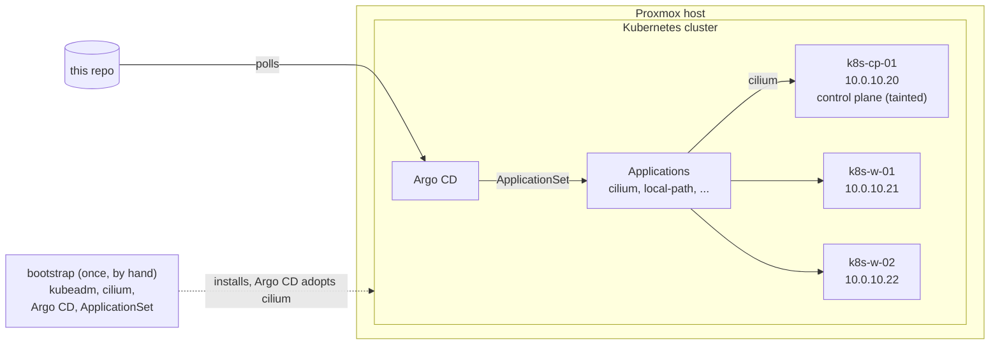

# homelab

Three-node Kubernetes cluster on one Proxmox server, run with Argo CD.



## Stack

| Layer | Tool | Notes |
|---|---|---|
| VMs | Terraform, `bpg/proxmox` 0.121 | cloud-init via the Proxmox API |
| OS | Debian 13 | |
| Node setup | Ansible | |
| Runtime | containerd 2.4 | from Docker's repo (Debian's 1.7 is too old) |
| Kubernetes | kubeadm 1.37 | upgraded by hand |
| Networking | Cilium 1.20 | kube-proxy kept |
| GitOps | Argo CD 3.6 | one folder per app |
| Storage | local-path-provisioner | default StorageClass |

Networks: LAN `10.0.10.0/24`, pods `10.244.0.0/16`, services `10.96.0.0/12`.

## Rebuild

1. [`terraform/`](terraform/): VMs
2. [`ansible/`](ansible/): node setup
3. [`kubernetes/`](kubernetes/): cluster and Argo CD, once by hand

After that, everything goes through [`kubernetes/apps/`](kubernetes/apps/).

## Common commands

```sh
export KUBECONFIG=~/.kube/homelab
kubectl -n argocd port-forward svc/argocd-server 8080:443   # Argo CD UI
kubectl config set-context --current --namespace argocd   # needed by --core
argocd app diff <app> --core
kubectl -n argocd annotate applicationset apps argocd.argoproj.io/application-set-refresh=true   # recheck git now
kubectl run nettest --rm -it --image=busybox:1.37 --restart=Never -- sh   # debug pod
```
